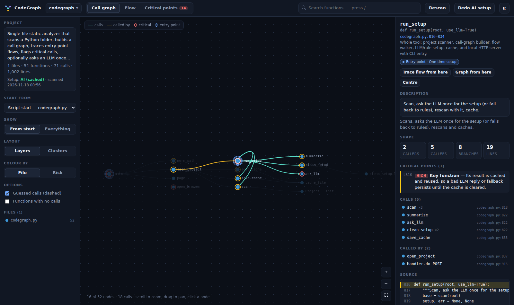
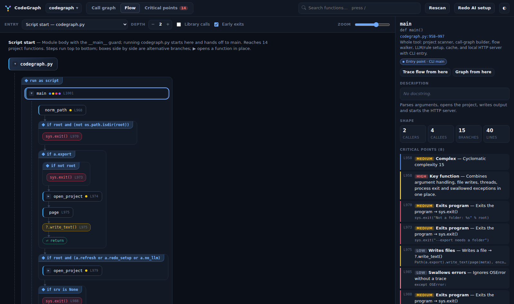
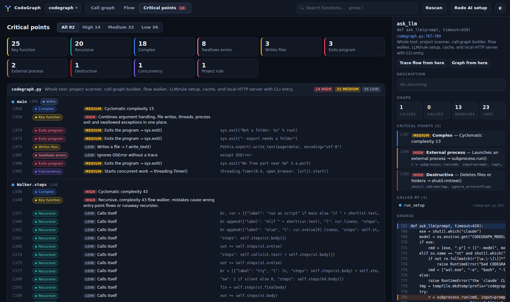

# CodeGraph

Point it at any Python folder and get an interactive map of the code in your browser.

- **Call graph**: every function is a node, linked to the functions it calls.
  Hover for the docstring; click for callers, callees, and source.
- **Flow**: start from an entry point and read the program top to bottom.
  `if/elif/else` and `try/except` are drawn as side-by-side branches, loops as
  boxes, and each called function expands in place.
- **Critical points**: per file, with the exact line. Process launches, file
  deletes, silently swallowed errors, unbounded loops, unsafe loads, high
  complexity, functions with many callers, and more.

The screenshots show CodeGraph analysing its own source.

## Flow from the entry point

## Critical points

## How it works

1. **First open of a folder**: the code is parsed with Python's `ast` module,
   then one call to the `claude` CLI writes the setup: entry points, key
   functions, project-specific risk rules, and file roles.
2. **Every later open**: loaded from the cache in `~/.codegraph`. No AI call.
3. **Rescan** re-reads the code with the stored setup (no AI call).
   **Redo AI setup** is the only action that calls the AI again.

Nothing is written into the folder you analyse. No AI available? Use
`--no-llm` for a rule-based setup.

## Usage

    python codegraph.py                      # start the app, pick a folder in the page
    python codegraph.py path/to/repo         # start with that folder open
    python codegraph.py path/to/repo --export graph.html   # one standalone HTML file

Options: `--refresh` (rescan), `--redo-setup`, `--no-llm`, `--port`, `--no-browser`.

Keep `codegraph.py` and `template.html` in the same folder.

## Requirements

- Python 3.9+ (standard library only)
- Optional: the `claude` CLI for the one-time AI setup. On Windows it is also
  found inside WSL.

## Notes

- Analysis is static. Calls on objects of unknown type are matched by method
  name only when the name is unique in the project; these are drawn dashed as
  "guessed" and can be hidden.
- The server binds to `127.0.0.1` and rejects non-local requests.
